# Despliegue de PokeDex en Deno Deploy

| | |
|---|---|
| **URL pública** | https://pokedex.aaron0510908.deno.net/ |
| **Repositorio** | https://github.com/Aaron0510908/pokedex |
| **Código fuente original** | `sistemas-distribuidos/poke-dex-lab/source/pokedex-angular.zip` del repositorio `rcuello/ac4dem1a` |
| **Calificación en securityheaders.com** | **A+** |

La creación de la cuenta y los permisos de GitHub están en [README.md](README.md). Este documento explica cómo se prepara, se compila y se publica la aplicación.

## 1. Qué se despliega

El enunciado muestra una PokeDex con 151 resultados, filtros y sprites:

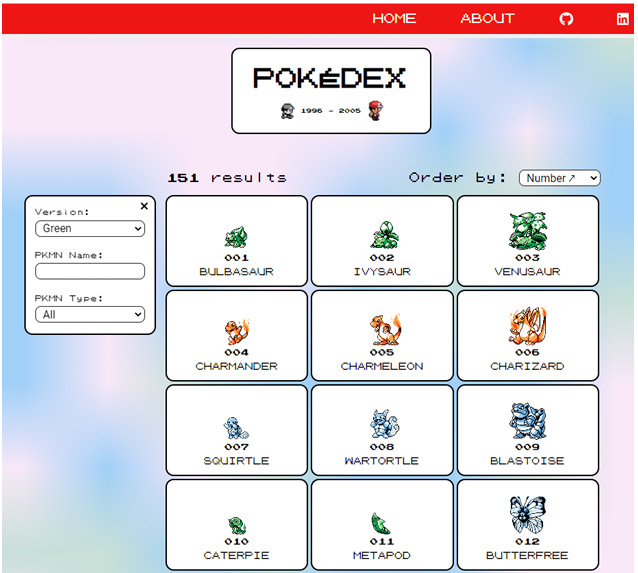

El código fuente es una aplicación **Angular 14** de Keiler Mora que consulta PokéAPI. El README del código fuente indica que, para desplegarla, se compila con `npm run build` y todo el contenido de `dist\pokedex-angular` queda listo para publicarse en cualquier servidor:

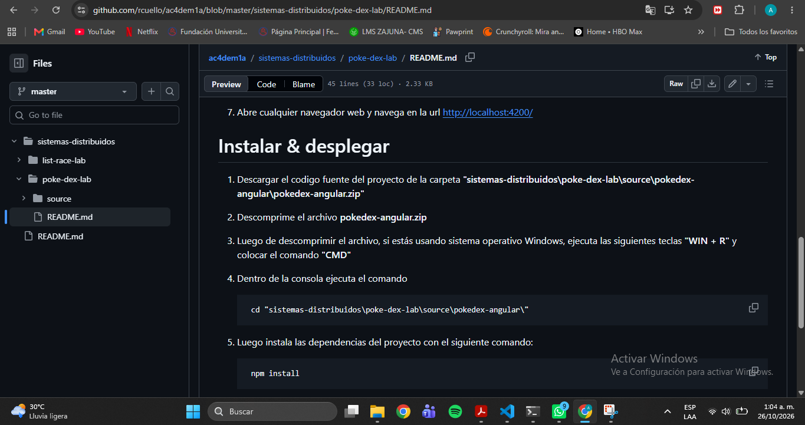

Como el resultado de la compilación son archivos estáticos, el despliegue consiste en **servirlos con un servidor mínimo en Deno** que además añade los encabezados de seguridad.

## 2. Requisitos previos

- Node.js v20.18.0 y npm 10.8.2
- Git 2.49 para Windows
- Visual Studio Code
- Cuenta de GitHub y cuenta en Deno Deploy (ver [README.md](README.md))
- StackEdit para escribir los documentos en Markdown

## 3. Obtener y compilar la aplicación

1. Descargué el repositorio `rcuello/ac4dem1a` como ZIP y extraje `pokedex-angular.zip` desde `sistemas-distribuidos/poke-dex-lab/source/`.
2. Ese ZIP **no trae una carpeta raíz**: al extraerlo en el Escritorio dejó 20 archivos sueltos. Los moví a una carpeta nueva llamada `pokedex-app` (ver el problema 3 en la sección 9).
3. Dentro de `pokedex-app` ejecuté:

```powershell
npm install
npm run build
```

La compilación termina con las tres etapas completas (*bundle generation*, *copying assets*, *index html generation*) y deja el resultado en `dist\pokedex-angular`.

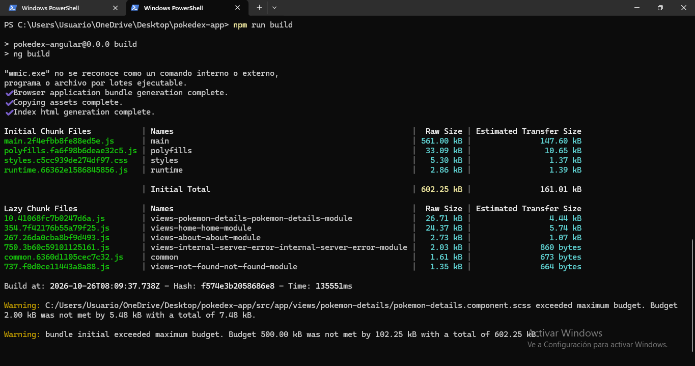

Mensajes que aparecen y **no afectan** el resultado:

- `wmic.exe no se reconoce...`: Angular intenta leer datos del sistema con un comando que Windows ya no incluye.
- Dos avisos de *budget*: el bundle y un archivo de estilos pesan más de lo configurado como límite de aviso.
- `npm install` muestra un error de **husky** (`.git can't be found`) porque la carpeta no es un repositorio Git. Ocurre en un paso final y no impide la compilación.
- `npm audit` reporta 52 vulnerabilidades en las dependencias del proyecto. **No** ejecuté `npm audit fix --force`, porque puede cambiar versiones mayores de Angular y romper la compilación. El sitio publicado contiene solo los archivos estáticos generados.

## 4. Ajustes antes de compilar para poder usar una CSP estricta

La Content-Security-Policy (CSP) es el encabezado que más puede romper una aplicación. Antes de la compilación final revisé el `index.html` generado y encontré tres elementos que una CSP sin `'unsafe-inline'` en scripts habría bloqueado.

### 4.1 Script de GitHub Pages en `src/index.html`

El autor publicó la aplicación en GitHub Pages, y por eso `src/index.html` incluye un script en línea (*Single Page Apps for GitHub Pages*) que redirige rutas. Aquí no hace falta: el servidor ya devuelve `index.html` para las rutas internas. Como es JavaScript en línea, lo eliminé junto con sus comentarios de inicio y fin.

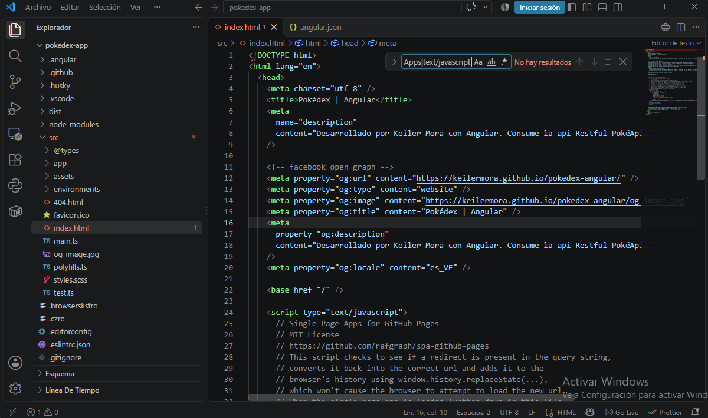

### 4.2 CSS crítico incrustado en `angular.json`

Por defecto, Angular incrusta el CSS "crítico" en el HTML con un bloque `<style>` y un `<link ... onload="...">`. Ambos son contenido en línea. En `angular.json`, dentro de la configuración `production`, agregué la clave `optimization` después de `"outputHashing": "all"` (sin olvidar la coma):

```json
"outputHashing": "all",
"optimization": {
  "scripts": true,
  "styles": {
    "minify": true,
    "inlineCritical": false
  },
  "fonts": true
}
```

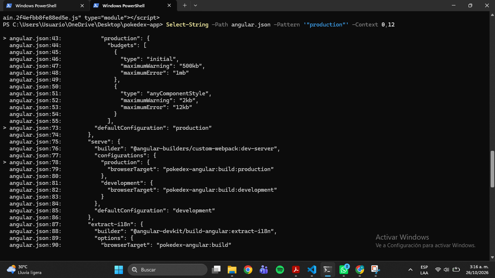

### 4.3 Verificación del HTML compilado

Tras recompilar con `npm run build`, comprobé el HTML generado:

```powershell
Select-String -Path "dist\pokedex-angular\index.html" -Pattern 'onload|<style|<script' | Select-Object -ExpandProperty Line
```

El resultado quedó con solo los tres `<script src="..." type="module">` y sin `<style>`, `onload` ni scripts en línea.

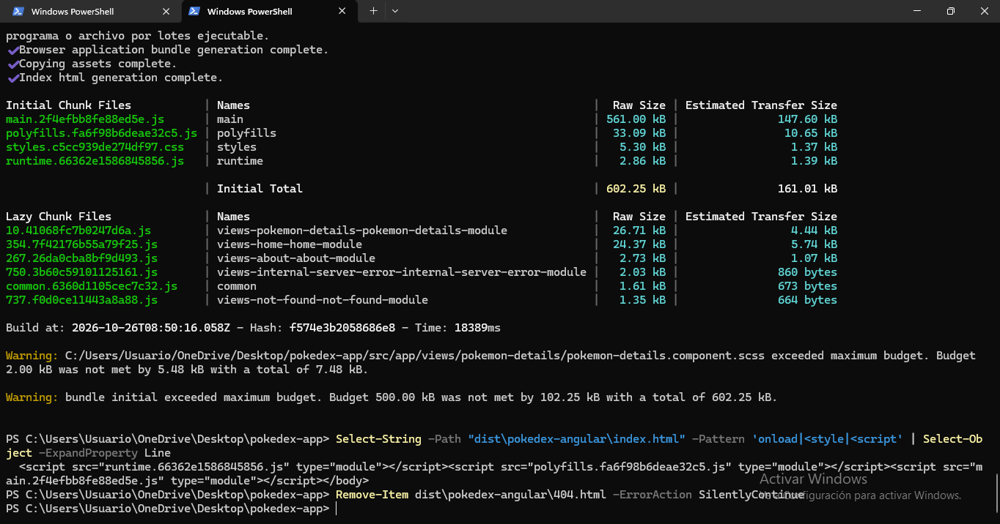

Además eliminé `dist\pokedex-angular\404.html`, que es otro archivo pensado para GitHub Pages:

```powershell
Remove-Item dist\pokedex-angular\404.html -ErrorAction SilentlyContinue
```

## 5. Preparar el repositorio

En el proyecto `POKEDEX` (el repositorio), copié **el contenido** de `dist\pokedex-angular` dentro de la carpeta `public`, de modo que `index.html` quedara directamente en `public/`. La carpeta se llama `public` en minúscula, porque Deno Deploy corre sobre Linux y distingue mayúsculas de minúsculas.

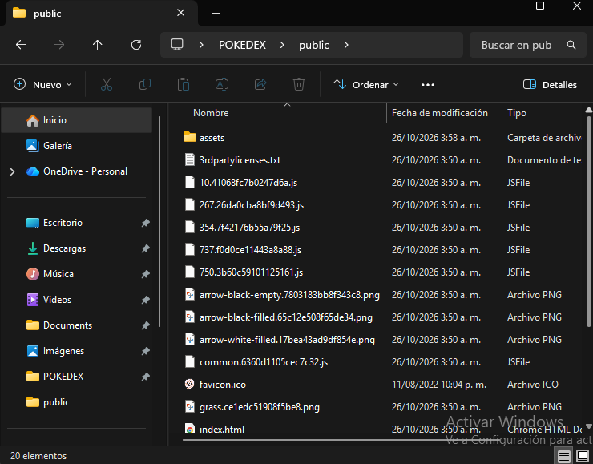

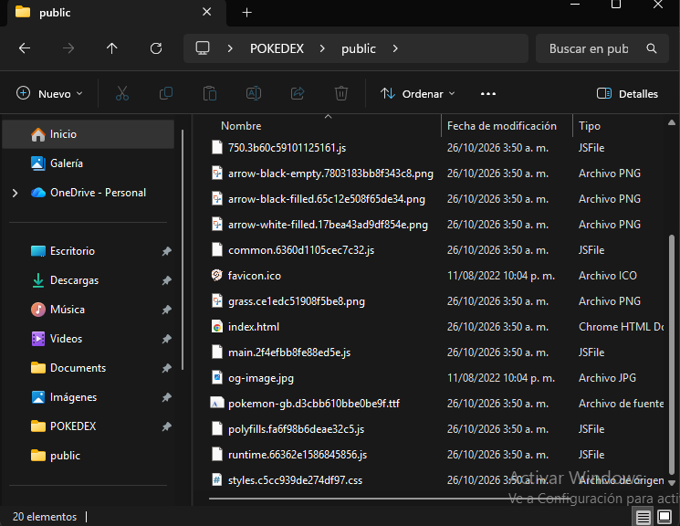

## 6. Servidor y encabezados de seguridad (`main.ts`)

El archivo `main.ts` en la raíz del repositorio es el punto de entrada. Sirve los archivos de `public/` y añade los encabezados de seguridad a cada respuesta:

```ts
import { serveDir } from "jsr:@std/http/file-server";

const securityHeaders: Record<string, string> = {
  "Strict-Transport-Security": "max-age=31536000; includeSubDomains; preload",
  "Content-Security-Policy":
    "default-src 'self'; " +
    "script-src 'self'; " +
    "style-src 'self' 'unsafe-inline' https://fonts.googleapis.com; " +
    "font-src 'self' data: https://fonts.gstatic.com; " +
    "img-src 'self' data:; " +
    "connect-src 'self' https://beta.pokeapi.co; " +
    "object-src 'none'; base-uri 'self'; form-action 'self'; frame-ancestors 'none'",
  "X-Frame-Options": "DENY",
  "X-Content-Type-Options": "nosniff",
  "Referrer-Policy": "strict-origin-when-cross-origin",
  "Permissions-Policy": "camera=(), microphone=(), geolocation=()",
  "Cross-Origin-Opener-Policy": "same-origin",
  "Cross-Origin-Resource-Policy": "same-origin",
};

const PREFIX = "/pokedex-angular";

Deno.serve(async (req) => {
  // La aplicación pide sus recursos bajo /pokedex-angular/ (ruta de GitHub Pages).
  // Se quita ese prefijo para encontrar los archivos en la raíz de public.
  const original = new URL(req.url);
  let request = req;
  if (original.pathname === PREFIX || original.pathname.startsWith(PREFIX + "/")) {
    original.pathname = original.pathname.slice(PREFIX.length) || "/";
    request = new Request(original, req);
  }

  let res = await serveDir(request, { fsRoot: "./public", quiet: true });
  const lastSegment = new URL(request.url).pathname.split("/").pop() ?? "";
  if (res.status === 404 && !lastSegment.includes(".")) {
    const url = new URL(request.url);
    url.pathname = "/index.html";
    res = await serveDir(new Request(url, request), { fsRoot: "./public", quiet: true });
  }

  const headers = new Headers(res.headers);
  for (const [k, v] of Object.entries(securityHeaders)) headers.set(k, v);
  return new Response(res.body, { status: res.status, headers });
});
```

Qué hace el código además de agregar encabezados:

- **Rutas internas:** si se pide una ruta sin extensión que no existe como archivo (por ejemplo `/about`), devuelve `index.html` para que Angular resuelva la ruta en el navegador.
- **Prefijo `/pokedex-angular`:** lo quita al buscar archivos (ver el problema 8).

### Encabezados y su función

| Encabezado | Función |
|---|---|
| Strict-Transport-Security (HSTS) | Obliga al navegador a usar siempre HTTPS con este dominio |
| Content-Security-Policy (CSP) | Define de dónde pueden cargarse scripts, estilos, fuentes, imágenes y conexiones; frena ataques XSS |
| X-Frame-Options | Impide que el sitio se muestre en un iframe (clickjacking) |
| X-Content-Type-Options | Evita que el navegador adivine el tipo de archivo |
| Referrer-Policy | Limita la información de origen enviada a otros sitios |
| Permissions-Policy | Desactiva cámara, micrófono y geolocalización |
| Cross-Origin-Opener-Policy / Cross-Origin-Resource-Policy | Aíslan el sitio de otros orígenes |

### Qué permite la CSP y por qué

| Directiva | Valor | Motivo |
|---|---|---|
| `script-src` | `'self'` | Solo scripts propios; sin scripts en línea |
| `style-src` | `'self' 'unsafe-inline' https://fonts.googleapis.com` | La aplicación usa Google Fonts (Roboto) y Angular crea estilos en línea (ver sección 8) |
| `font-src` | `'self' data: https://fonts.gstatic.com` | Fuentes propias y de Google Fonts |
| `img-src` | `'self' data:` | Los sprites vienen incluidos en `assets/` |
| `connect-src` | `'self' https://beta.pokeapi.co` | La aplicación consulta `https://beta.pokeapi.co/graphql/v1beta` |
| `frame-ancestors`, `object-src` | `'none'` | Sin iframes ni plugins |

## 7. Subir a GitHub y desplegar

Subida inicial del proyecto:

```powershell
cd $HOME\OneDrive\Desktop\POKEDEX
git init
git add .
git commit -m "PokeDex: codigo fuente y servidor con headers de seguridad"
git branch -M main
git remote add origin https://github.com/Aaron0510908/pokedex.git
git push -u origin main
```

Cada cambio posterior se sube con:

```powershell
git add .
git commit -m "Descripcion del cambio"
git push
```

Deno Deploy está conectado al repositorio, así que **cada `git push` a `main` genera un build nuevo y lo publica en producción** (despliegue continuo). La configuración de la aplicación (raíz del repositorio, punto de entrada `main.ts`, sin comandos de instalación ni compilación) está descrita en [README.md](README.md).

Build final en verde:

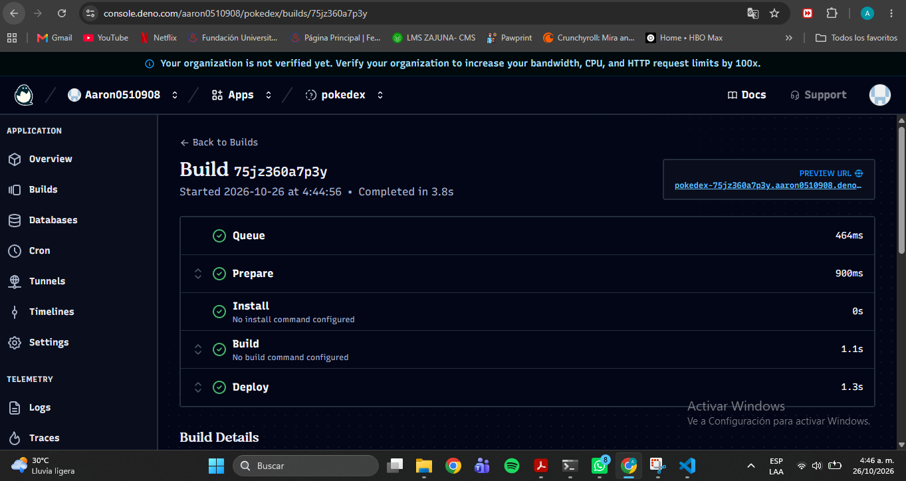

Lista de builds, con la etiqueta **Production** en el más reciente:

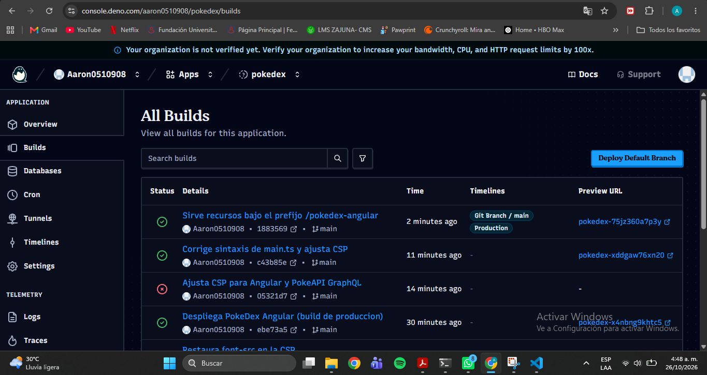

## 8. Verificación

- La aplicación carga en https://pokedex.aaron0510908.deno.net/ con los **151 resultados** y sus sprites, igual que en el enunciado.
- La sección **About** carga correctamente.
- La consola del navegador queda sin errores.
- Escaneo en https://securityheaders.com/: **A+**.

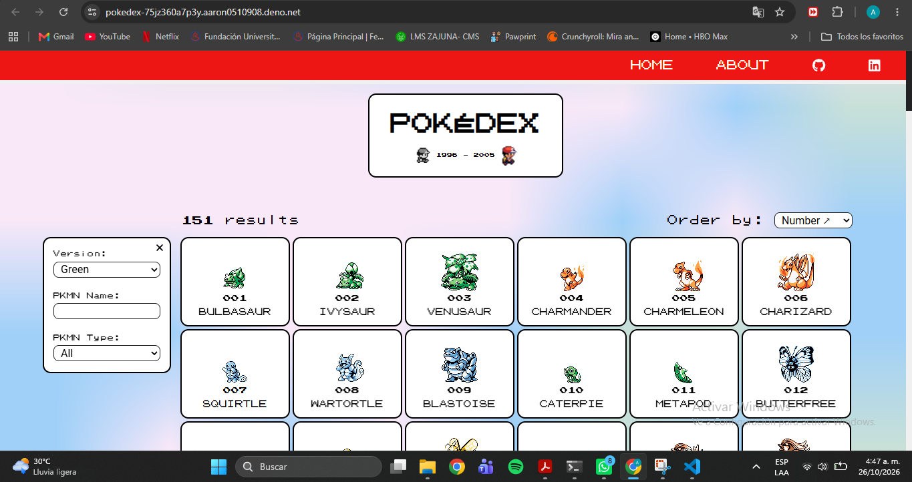

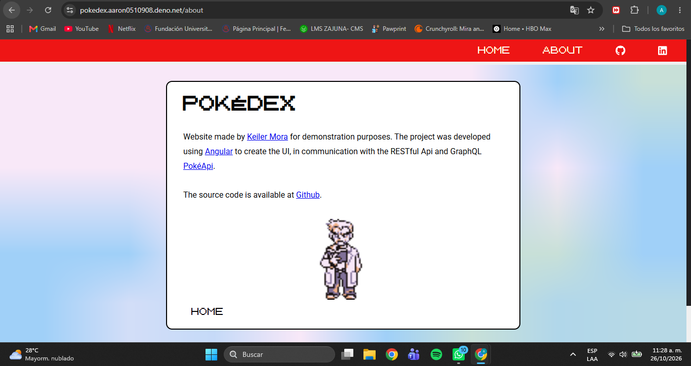

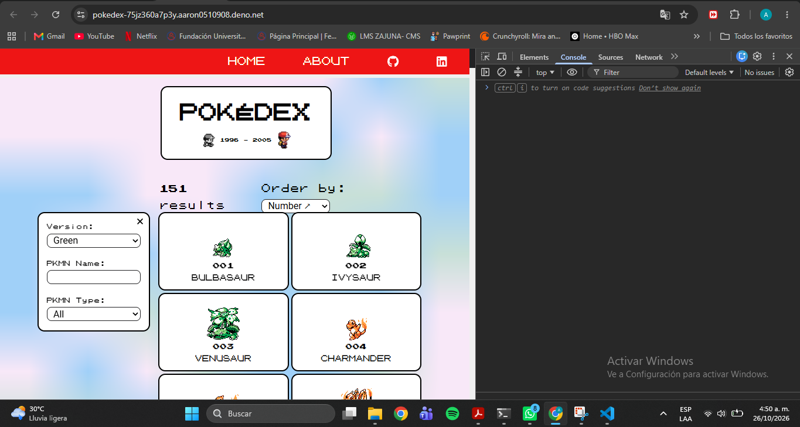

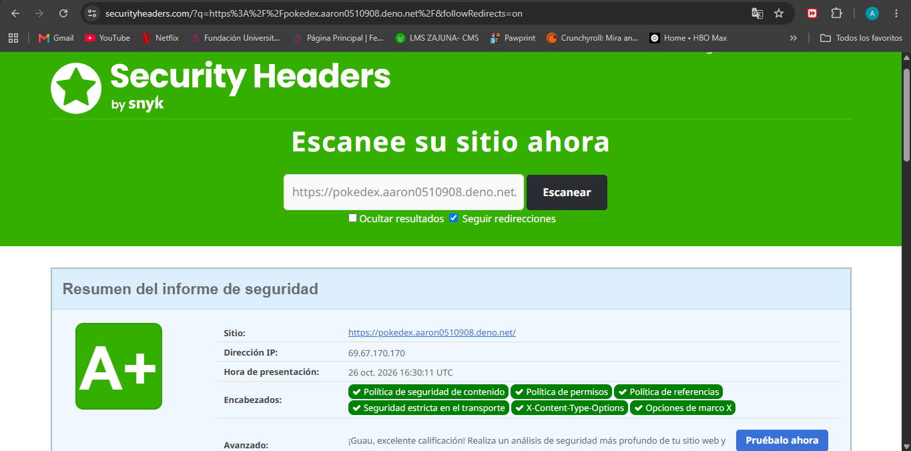

### Decisión de seguridad: `'unsafe-inline'` solo en `style-src`

Angular crea los estilos de cada componente como etiquetas `<style>` en tiempo de ejecución. Una CSP con `style-src 'self'` las bloquea y la página se ve sin estilos (ver el problema 7). Para que la aplicación funcione permití `'unsafe-inline'` **solo en `style-src`**, y mantuve `script-src 'self'` **sin** ejecución de scripts en línea, que es la restricción más importante contra XSS.

Es un compromiso consciente: los estilos en línea son menos peligrosos que los scripts en línea. Una mejora posible es usar un *nonce* generado por el servidor para cada visita, pero implica reescribir el HTML en cada respuesta y no lo implementé.

## 9. Problemas encontrados y soluciones

| # | Problema | Solución |
|---|---|---|
| 1 | Mi primer intento usó otra carpeta del repositorio (`list-race-lab`), una plantilla de directorio, que no coincidía con la imagen del enunciado | Identifiqué la carpeta correcta, `poke-dex-lab`, y reemplacé el contenido de `public` por la aplicación Angular compilada |
| 2 | `pokedex` no aparecía al crear la aplicación en Deno Deploy | Faltaban permisos de la aplicación de Deno en GitHub; los otorgué y luego los restringí al repositorio necesario (ver README.md) |
| 3 | El ZIP no trae carpeta raíz y dejó 20 archivos sueltos en el Escritorio | Los moví a una carpeta nueva `pokedex-app` y trabajé desde ahí |
| 4 | `npm run build` falló con `Missing script: "build"` | Estaba ejecutando los comandos en `C:\Users\Usuario` y no en la carpeta del proyecto; abrí PowerShell dentro de `pokedex-app` |
| 5 | `npm install` terminó con un error de husky | No afecta la compilación; el build funcionó normalmente |
| 6 | El HTML compilado traía un `<style>`, un `onload` y un script de GitHub Pages que la CSP bloquea | Desactivé `inlineCritical` en `angular.json` y eliminé el script de `src/index.html` (sección 4) |
| 7 | En producción la página se veía sin estilos y la consola mostraba errores de CSP | La CSP original bloqueaba Google Fonts, los estilos en línea de Angular y las peticiones a `beta.pokeapi.co`; ajusté `style-src`, `font-src` y `connect-src` |
| 8 | Los sprites devolvían error 404 en la ruta `/pokedex-angular/assets/...` | La aplicación pide sus recursos bajo ese prefijo (ruta de GitHub Pages); el servidor lo quita al buscar archivos |
| 9 | El build de Deno falló con `SyntaxError` en `main.ts` | Al editar el bloque de la CSP quedó un desajuste de sintaxis; reemplacé el archivo completo y el build pasó a verde |

Evidencias de los problemas 7, 8 y 9:

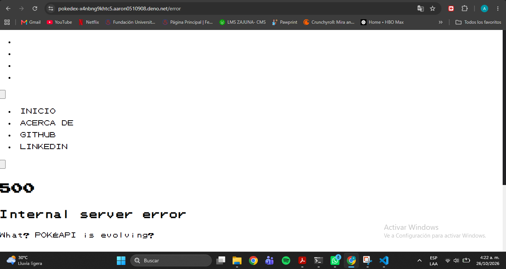

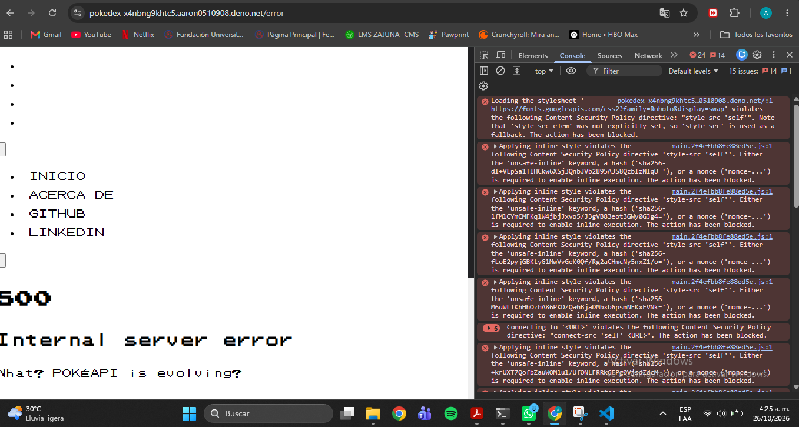

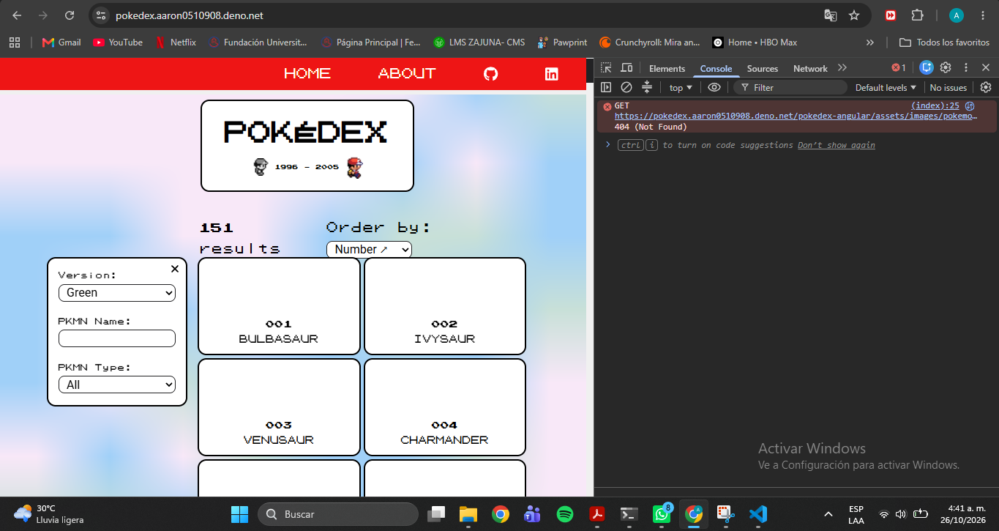

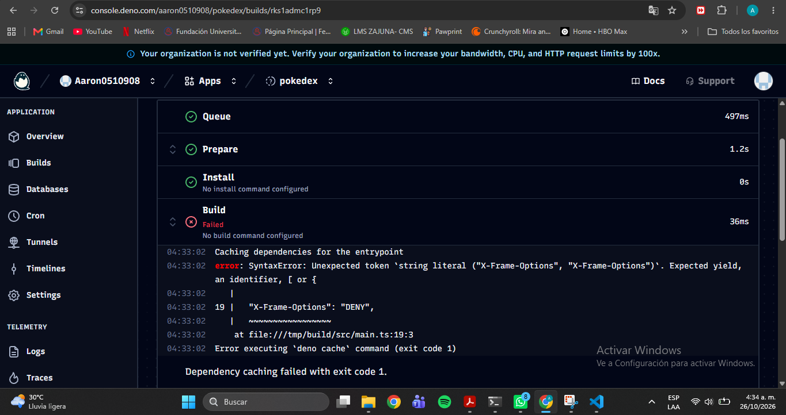

Evidencias de los problemas 3 y 4:

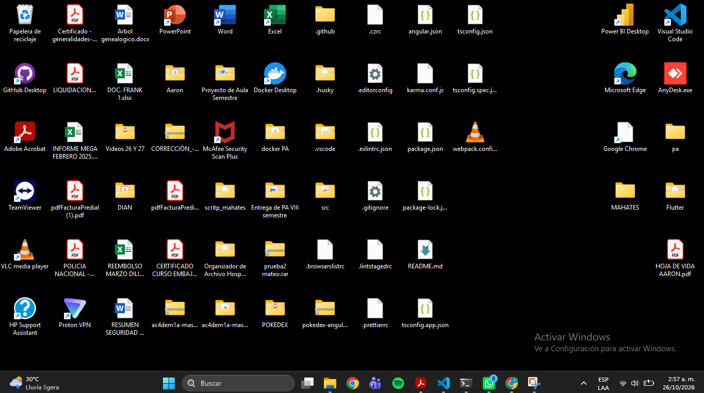

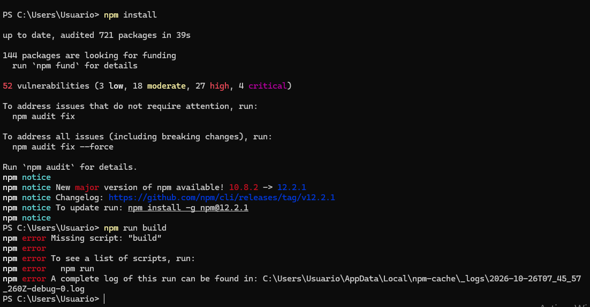

## 10. Auditorías adicionales

Intenté analizar el sitio con SSL Labs, pero la herramienta no pudo obtener el certificado ni emitió calificación, así que no incluyo ese resultado. El sitio se sirve correctamente por HTTPS, como confirman el navegador y securityheaders.com (el encabezado HSTS aparece en verde).
