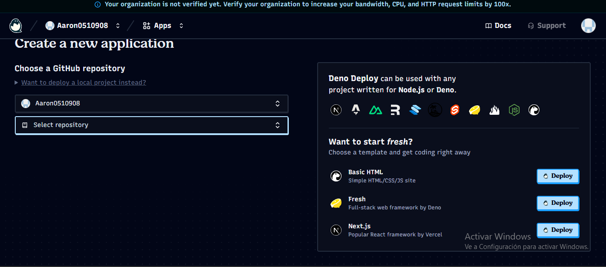
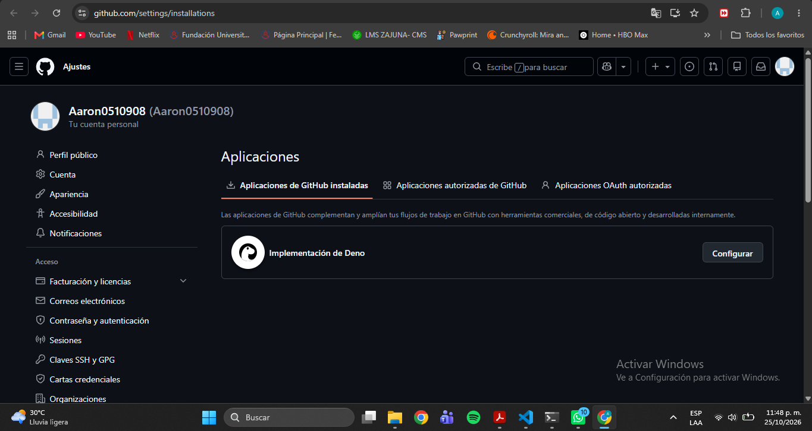
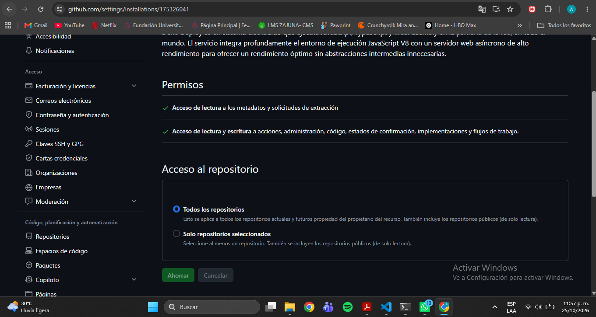
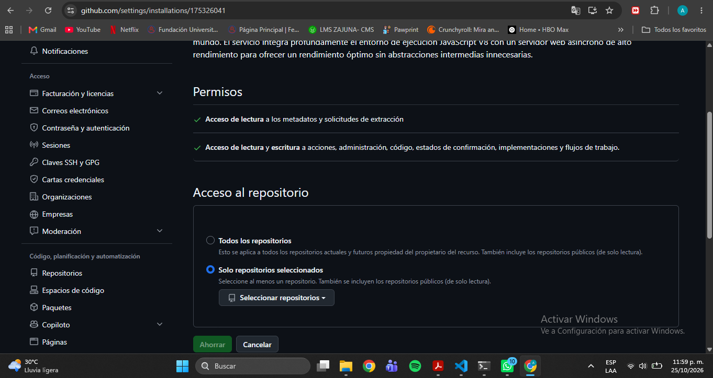
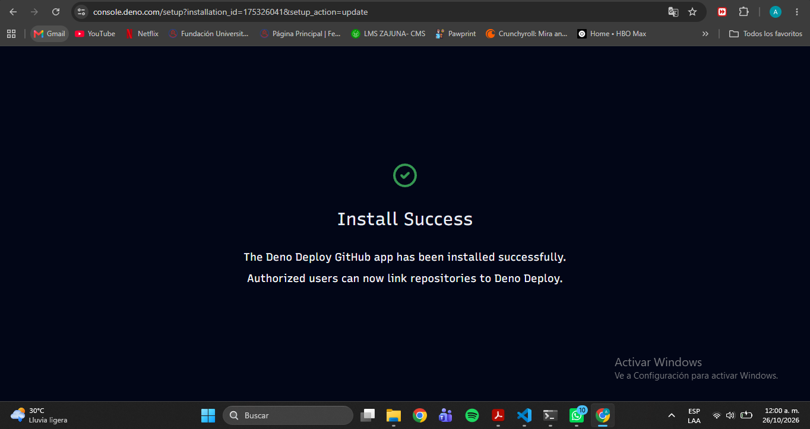
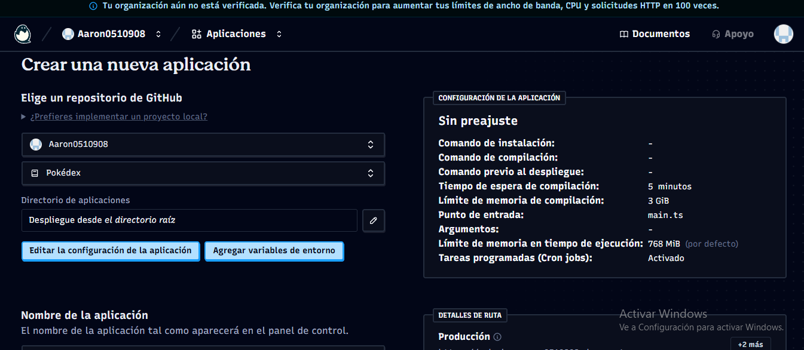

# PokeDex – Despliegue en Deno Deploy

| | |
|---|---|
| **Autor** | Aaron0510908 |
| **Aplicación (URL pública)** | https://pokedex.aaron0510908.deno.net/ |
| **Repositorio** | https://github.com/Aaron0510908/pokedex |
| **Plataforma en la nube** | Deno Deploy (https://console.deno.com) |
| **Calificación en securityheaders.com** | **A+** |

## Descripción

Despliegue de la aplicación **PokeDex** solicitada por Pueblo Paleta Inc. El código fuente es una aplicación **Angular** desarrollada por Keiler Mora que consulta la API pública PokéAPI (GraphQL). Se compila a archivos estáticos y se publica con un servidor mínimo en Deno que agrega **encabezados HTTP de seguridad** a cada respuesta.

El proceso técnico de publicación (compilación, servidor, encabezados, problemas encontrados) está en [Despliegue.md](Despliegue.md). Este documento explica **cómo se creó la cuenta en la nube y su configuración inicial**.

## ¿Por qué Deno Deploy?

- Entrega **HTTPS automático**, requisito para el encabezado HSTS.
- Se conecta con GitHub y **redespliega en cada `git push`**.
- La aplicación, una vez compilada, es de archivos estáticos y no necesita servidores propios.
- Tiene un plan gratuito.

## Creación de la cuenta paso a paso

### 1. Cuenta y repositorio en GitHub

Deno Deploy usa GitHub para iniciar sesión y para obtener el código, así que primero se necesita una cuenta de GitHub. Mi usuario es `Aaron0510908`.

En GitHub creé un repositorio **público** llamado exactamente `pokedex`, **sin marcar** las opciones de agregar README, `.gitignore` o licencia, para que quedara vacío y no hubiera conflictos en el primer envío.

### 2. Ingreso a Deno Deploy

1. Entré a https://console.deno.com.
2. Elegí iniciar sesión **con GitHub** y autoricé el acceso a mi cuenta.
3. Deno Deploy exige una **organización** antes de crear aplicaciones. La mía quedó con el nombre `aaron0510908`, que además forma parte de la URL pública (`pokedex.aaron0510908.deno.net`).

Al entrar aparece un aviso de que la organización no está verificada. Solo implica límites más bajos de ancho de banda y CPU, y no afecta este trabajo.

### 3. Permisos de GitHub (problema inicial y solución)

Al pulsar **New App**, el repositorio `pokedex` **no aparecía** en la lista de repositorios. La causa es que la aplicación de Deno Deploy en GitHub todavía no tenía permiso sobre mis repositorios.



Lo resolví desde la opción de configurar los permisos de la aplicación de GitHub. En GitHub, en *Ajustes → Aplicaciones*, aparece instalada como **"Implementación de Deno"**:



La pantalla de configuración permite elegir qué repositorios puede ver. La aplicación tiene permisos de **lectura y escritura sobre el código**, así que, siguiendo el principio de **mínimo privilegio**, cambié la opción **"Todos los repositorios"** por **"Solo repositorios seleccionados"**.





Al guardar, Deno Deploy confirmó la instalación:



Después lancé un despliegue de prueba para confirmar que el cambio de permisos no rompió la conexión con el repositorio, y terminó en verde.

### 4. Creación de la aplicación

1. En https://console.deno.com pulsé **New App**.
2. Seleccioné el repositorio `pokedex`.
3. Deno detectó la configuración automáticamente:
   - **Directorio de la aplicación:** raíz del repositorio.
   - **Punto de entrada:** `main.ts`.
   - **Comandos de instalación y de compilación:** ninguno (el código ya se sube compilado).
4. Pulsé **Create App**. Esto crea la aplicación y lanza el primer build.



El detalle de cómo se prepara el código y de qué hace el punto de entrada `main.ts` está en [Despliegue.md](Despliegue.md).

## Resultado

La aplicación queda publicada en **https://pokedex.aaron0510908.deno.net/**:


Escaneo de seguridad en https://securityheaders.com/ sobre la URL de producción: **A+**, con los seis encabezados evaluados en verde.


## Estructura del repositorio

```
pokedex/
├── main.ts          # Servidor en Deno + encabezados de seguridad
├── public/          # Aplicación Angular ya compilada (archivos estáticos)
├── README.md        # Creación de la cuenta y configuración inicial
├── Despliegue.md    # Proceso de despliegue y seguridad
└── img/             # Capturas usadas en la documentación
```
